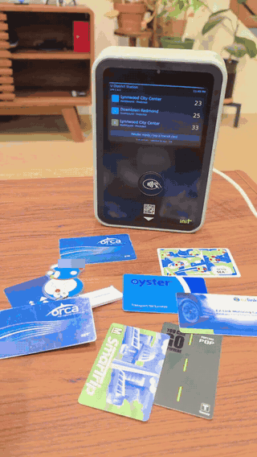
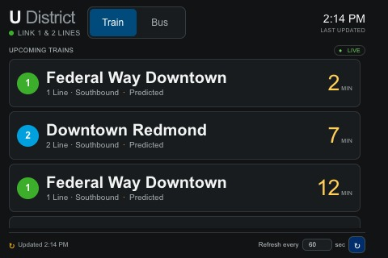

# Transit Times for Pi & PROXmobil3

Live rail and bus arrivals from OneBusAway, with card-triggered photo albums on
an upcycled PROXmobil3 transit terminal. The original Raspberry Pi browser kiosk
is also included.

## Demo

[](docs/media/pm3-demo.mp4)

[Watch the nine-second demo (MP4)](docs/media/pm3-demo.mp4).
The recording shows U District Station arrivals and different cards selecting
photo albums. The shared copies are silent, omit recording/location metadata,
and obscure only printed ORCA card numbers. The original recording stays outside
this repository. The clip shows album selection; the configured return to arrivals
happens after the recording ends.

## Choose a platform

| | PROXmobil3 | Raspberry Pi |
| --- | --- | --- |
| App | Native Rust + Slint | React/Vite + Python API server |
| Display | 800 × 480 framebuffer; central 754 pixels visible | 480 × 320 HDMI touchscreen |
| Arrivals | OneBusAway, automatic paging | OneBusAway SDK, scrollable list |
| Photo albums | Per-card albums on USB | Not implemented |
| Settings | Private JSON; restart to apply | JSON schedule and on-screen refresh input |
| Runtime | Static native app and installed curl | Python and Chromium; Node only for frontend builds |
| Guide | [PM3 setup](pm3/README.md) | [Pi setup](pi/README.md) |

## PM3: current behavior

- Live arrivals while idle, with configurable polling, paging, cache expiry and
  network-error backoff. Network requests run separately from rendering/card input.
- Tap an enrolled card to select its USB photo album. Unconfigured cards do not
  select an album. A configured card can switch to another album after the tap
  cooldown. The display returns to arrivals when the photo session ends.
- Arrange photos on your computer, then sync resized copies to the USB drive.
  Original photos stay on your computer; no photo server or extra Pi is required.
- Audio is disabled by default. Known cards use private, salted local fingerprints;
  the app does not perform fare transactions or infer the issuing agency.

**Deployment is currently a bounded prototype session**, normally one hour.
Permanent startup, full OS recovery images and PM3 power scheduling remain pending.
The Pi schedule does not apply to the PM3.

| Pending capability | Status |
| --- | --- |
| Japanese FeliCa cards | Paused pending a compatible discovery interface; [backlog issue #2](https://github.com/joncady/OneBusAwayTransitTimesForPi/issues/2) |
| Audio | Muted; amplifier pop unresolved |
| QR scanner | Deferred after an unsuccessful trial; not integrated |
| Touch input | No usable controller exposed on the inspected PM3 |

## Private configuration

For a fresh checkout:

```sh
cp .env.example .env
cp config/transit.example.json config/transit.json
```

Keep existing private files if you have already configured the app. Put your
OneBusAway key in `.env` as `API_KEY=...`. `PI_PASSWORD` is used only by the Pi's
password-based deployment script; PM3 deployment uses your SSH key.

Replace the station names, service labels and plain stop IDs in every configured
mode. PM3 can omit unused modes; its default selected mode is `train`. The Pi UI
provides train/bus controls. The shared examples use placeholders so they do not
publish a personal location.

Both implementations validate transit configuration on load. The PM3 also rejects
unknown fields and checks configuration bounds. Do not commit `.env`, the real
`config/transit.json`, card registries, private album maps, logs or discovery captures.
See [configuration examples](config/transit.example.json) and
[PM3 display settings](pm3/display.example.json).

## PM3 quick start

On the development computer you need Docker running, Python 3 and SSH. The PM3
needs working Ethernet, key-based SSH and its existing USB bootstrap. These
scripts preserve that bootstrap; they do not set up SSH or install a boot service.
Start with the [community SSH instructions](https://wiki.pm3.dev/ssh) if necessary.

Run from the repository root, replacing the SSH destination:

```sh
PM3_TARGET='root@device-host'
ssh -o BatchMode=yes "$PM3_TARGET" 'uname -m'
./pm3/deploy-live.sh "$PM3_TARGET" 3600
```

The script cross-compiles, validates incoming configuration and starts a one-hour
live session. It reuses private `config/transit.json`; editing ignored
`pm3/runtime.local/display.json` changes polling/mode/paging on the next deployment.
A device-only station change is overwritten by the next deployment's local config.

For an already deployed app:

```sh
# Start another one-hour live session, including after the old unit expires.
ssh "$PM3_TARGET" '/init/transit-prototype/restart-display.sh 3600 live'

# Stop gracefully.
ssh "$PM3_TARGET" 'systemctl stop transit-prototype.service'
```

Build only with `./pm3/build.sh`. Existing tests are opt-in with `--test`.
For sample mode, card enrollment/naming, albums and recovery, follow the
[complete PM3 process](pm3/README.md).

## Card albums

1. Deploy the PM3 app and enroll/name cards one at a time, checking a repeated tap
   after removing the card for two seconds.
2. Create a private action file from [albums.example.json](pm3/albums.example.json).
3. Create `~/Desktop/Transit Albums/<saved card label>/` folders and add photos.
4. Install the development-machine media dependency and sync:

```sh
python3 -m venv .venv-media
.venv-media/bin/python -m pip install -r pm3/requirements-media.txt
.venv-media/bin/python pm3/sync-albums.py "$PM3_TARGET"
```

Folder names must match enrolled labels. JPEG, PNG, HEIC/HEIF and WebP inputs are
prepared as resized, oriented JPEG copies; HEIC conversion uses macOS `sips`.
The tool strips EXIF/location metadata, keeps previous USB releases, updates the
private album map and starts another one-hour live session. It currently supports
up to 32 mapped albums and 512 photos per album. Do not remove USB bootstrap files.

See [album setup and controls](pm3/README.md#arrange-albums-on-your-development-computer)
for the initial action-file command, preparation-only mode and timing settings.

## Raspberry Pi version



The Pi version uses the official OneBusAway Python SDK and Chromium. Its default
schedule is 7–8 AM Monday–Friday, with touch wake and five minutes of activity
outside scheduled hours. Refresh rate is editable on screen.

For local development, frontend builds and one-command deployment, see
[the Pi guide](pi/README.md). The production Pi does not need Node.js.

## References and backlog

- [Hardware, API, toolkit and related-project references](pm3/REFERENCES.md)
- [PM3 source layout, privacy and recovery handoff](docs/pm3-repository-handoff.md)
- [Hardware/software audit](docs/pm3-audit-2026-10-21.md)
- [Japanese-card research and resume criteria](docs/pm3-felica-parallel-research.md)
- [Project backlog](BACKLOG.md) · [GitHub issues](https://github.com/joncady/OneBusAwayTransitTimesForPi/issues)
